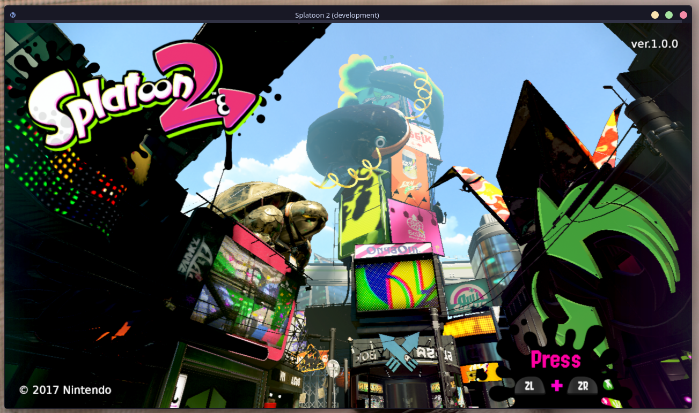
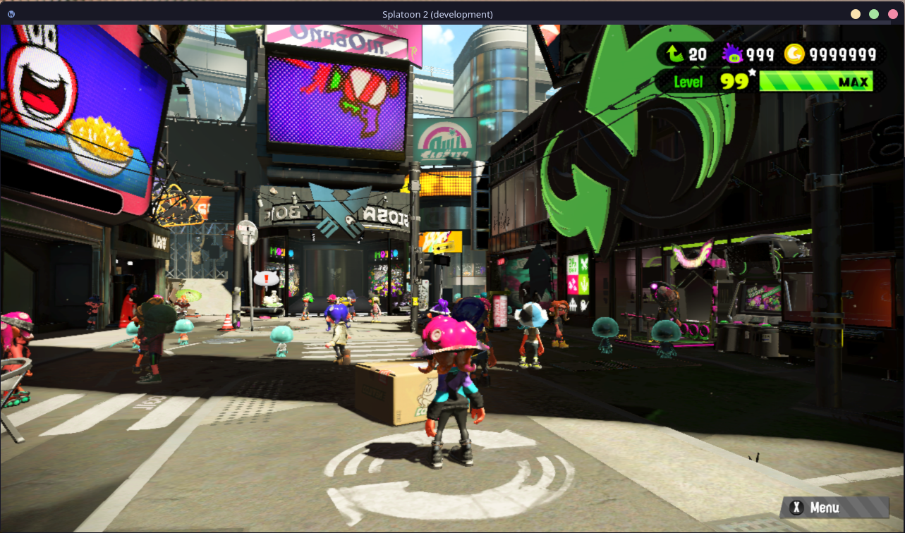
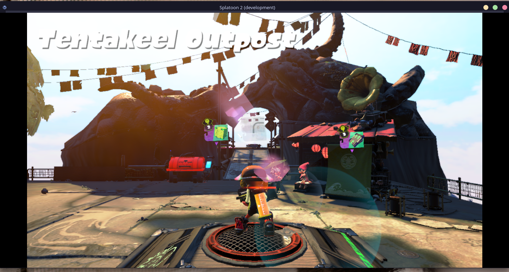

# Kraken

### Splatoon 2 · Native recompilation for Linux

**Experimental · Linux x86-64 · Vulkan · Splatoon 2 v5.5.2**

*An independent, work-in-progress project based on [Peiikai's LAS Recomp](https://github.com/peiikai/LASRecomp).*

> [!IMPORTANT]
> **Kraken is under active development.** The standalone source code and playable builds have **not** been released. This repository currently documents the project and its progress.

## Overview

Kraken aims to run **Splatoon 2** natively on **Linux x86-64** through static recompilation rather than conventional console emulation. Its tooling recompiles game executable code for native execution, while the runtime translates NVN graphics operations to **Vulkan**.

The project targets **Splatoon 2 version 5.5.2**. Full-game compatibility, stability and performance have not been established.

**Windows and macOS support are planned for the future.** Currently, development is focused on Linux.

Kraken also supports the **Octo Expansion DLC**, although the DLC is **not required** to use Kraken or play the base game.

## Screenshots

*Captured from local development builds. These images are not a promise of complete compatibility.*

### Title screen

### Inkopolis Square

### Tentakeel Outpost

## Development status

Local testing has reached the title screen, **Inkopolis Square**, and **Tentakeel Outpost**.

The first boss, **Octo Oven (Sector 1)**, is **fully beatable** in the current development build.

> [!WARNING]
> **Kraken is not publicly playable yet.** This repository does not currently contain the standalone source tree, installers, binaries or downloadable builds. There is no announced release date.

## Game files and copyright

> [!IMPORTANT]
> **No playable Nintendo game files are included or distributed.** Kraken does not provide game executables, ROMs, extracted game assets, firmware, encryption keys, saves, generated game code or shader caches. The screenshots above are development captures that depict Nintendo-owned game imagery.
>
> Any future build workflow will require users to supply their own appropriately obtained copy of **Splatoon 2 v5.5.2**, with game-specific extraction and code generation performed locally.

> [!CAUTION]
> Kraken is an **unofficial fan project**. It is not affiliated with, sponsored by, approved by or endorsed by Nintendo. *Splatoon 2* and its associated intellectual property belong to Nintendo and their respective owners.

## AI-assisted development

> [!NOTE]
> **Kraken has been co-developed with AI assistants.** AI tools have contributed to implementation, debugging, technical investigation and documentation. The project owner directs development, integrates changes and manually tests gameplay and rendering.
>
> AI-generated or AI-assisted changes are not considered correct without verification.

## Credits and licensing

Kraken builds upon **[Peiikai's LAS Recomp](https://github.com/peiikai/LASRecomp)** and its contributors. The upstream project's own source code is licensed under the **MIT License**, with its copyright and permission notices preserved in [LICENSE](LICENSE). Third-party components have their own licenses and attribution requirements.

Kraken is an independent project, not an official Nintendo product.

---

Kraken · A work-in-progress Splatoon 2 recompilation project

